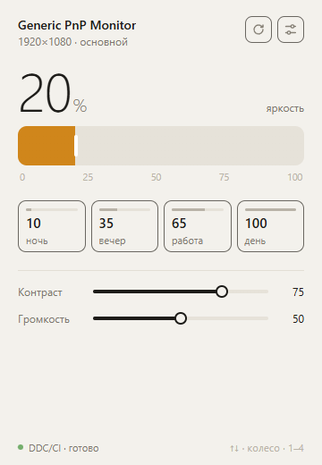
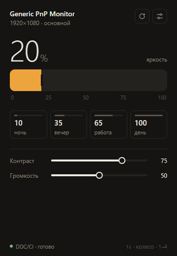
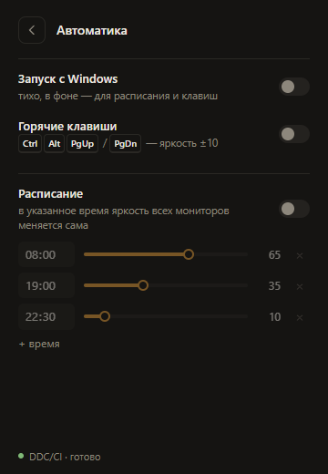
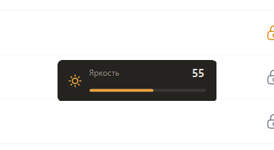

# Monitor Config

Компактная панель для внешних мониторов на Windows: яркость, контраст и громкость по **DDC/CI**, плюс автоматика — расписание яркости, глобальные горячие клавиши и запуск вместе с Windows.

Без зависимостей: Node.js + встроенный PowerShell. Окно — Edge/Chrome в режиме приложения.

<p>
  
  
  
</p>

## Запуск

Нужен [Node.js](https://nodejs.org) 18+.

```
git clone https://github.com/vladkolchik/monitorconfig
```

Двойной клик по `MonitorConfig.vbs` — откроется окно без консоли. Или `npm start`.

Повторный запуск при уже работающем приложении просто открывает ещё одно окно.

## Управление

| Что | Как |
| --- | --- |
| Яркость | ползунок, колесо мыши (±2), стрелки (±5) |
| Пресеты | кнопки или клавиши `1`–`4`: 10 / 35 / 65 / 100 |
| Контраст, громкость | показываются, если монитор их поддерживает |
| Несколько мониторов | вкладки сверху |

### Автоматика (кнопка с ползунками справа вверху)

- **Запуск с Windows** — кладёт `MonitorConfig.vbs` в папку автозагрузки; сервис стартует тихо, без окна.
- **Горячие клавиши** — `Ctrl+Alt+PgUp` / `Ctrl+Alt+PgDn` меняют яркость всех мониторов на ±10 из любой программы. Внизу экрана на секунду всплывает плашка с уровнем — она не забирает фокус и пропускает клики.

  
- **Расписание** — в заданное время яркость всех мониторов выставляется сама. При включении сразу применяется уровень, действующий сейчас.

Пока включены расписание или горячие клавиши, приложение остаётся работать в фоне после закрытия окна. Остановить — «Завершить» на экране автоматики. Без автоматики сервер завершается сам через ~15 секунд после закрытия окна.

Настройки: `%APPDATA%\MonitorConfig\settings.json`.

## Если монитор «не отвечает»

- Включите **DDC/CI** в экранном меню монитора (часто выключено по умолчанию).
- Встроенные экраны ноутбуков через DDC/CI не управляются.
- Некоторые док-станции и переходники USB-C → HDMI не пропускают DDC/CI.

## Как устроено

```
public/        интерфейс (HTML/CSS/JS без сборки)
server.js      локальный HTTP-сервер на 127.0.0.1:47821, расписание, автозапуск
ddc.ps1        долгоживущий PowerShell-воркер: dxva2.dll (DDC/CI), RegisterHotKey, плашка яркости
test/smoke.js  сквозной тест на реальном мониторе
```

Запросы к монитору идут строго по одному, а быстрые движения ползунка схлопываются до последнего значения — шина DDC/CI медленная, так она не захлёбывается.

## Тесты

```
npm test             # API, запись в монитор, горячие клавиши и плашка, расписание, автозапуск
npm test -- --full   # плюс ждёт до ~70 с, пока слот расписания сработает сам
```

Тест работает с реальным монитором на отдельном порту и во временной папке настроек, нажимает горячие клавиши и в конце возвращает исходную яркость.
